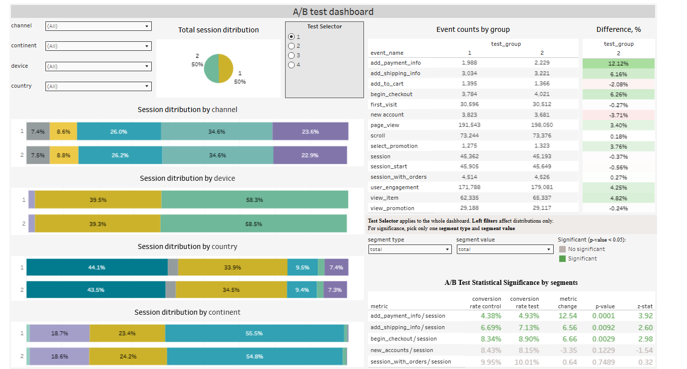

# A/B Testing Analysis: Checkout Funnel Metrics

## 📌 Overview
Statistical analysis of four A/B tests of an e-commerce website. For each test, I compared the control group (A) and the variant group (B) across five conversion metrics (four checkout-funnel metrics and purchase conversion), each measured per session, using a two-proportion z-test. Results are calculated overall and by segment (country, device, continent, traffic channel) and visualised in an interactive Tableau dashboard.

## 🎯 Hypothesis
For every metric:
- **H0:** the conversion rate is the same in the control and variant groups
- **H1:** the conversion rates differ (two-sided test, α = 0.05)

## 📂 Data
- **Source:** Google BigQuery, project `data-analytics-mate`, dataset `DA` (tables: `ab_test`, `session`, `session_params`, `order`, `event_params`, `account_session`)
- **Volume:** 542,142 sessions in total across all tests
- **Output file:** `data/ab_test_significance_portfolio2.csv` is the final table with test results by segment, produced by the notebook and used in Tableau

## 🛠 Tools
Python (pandas, NumPy, SciPy, statsmodels), Google BigQuery (SQL with CTEs, JOINs, UNION ALL), Google Colab, Tableau Public

## 🔍 Methodology
1. Extracted session-level data from BigQuery with a SQL query (CTEs joining sessions, parameters, orders, events and accounts), aggregated by date, country, device, continent, channel, test and test group.
2. Defined the metrics in a dictionary: `add_payment_info`, `add_shipping_info`, `begin_checkout`, `new_accounts` and `session_with_orders`, each divided by sessions. A new metric can be added with one line of code.
3. Wrote a function for a two-proportion z-test (conversion rates, relative change, z-statistic, p-value).
4. Applied it in loops to all tests and metrics, then to segments: top-5 countries + "Other countries", devices, continents, channels.
5. **Validated the results twice:** total sessions match the raw data (542,142), and z-statistics and p-values match `statsmodels`.
6. Exported the final table to CSV and built a Tableau dashboard (sample-balance check between groups and significance results, with one parameter to switch between tests).

## 📊 Key Results

| Test | Result | Decision |
|---|---|---|
| **1** | Significant increase in `add_payment_info` (+12.54%, p = 0.0001), `add_shipping_info` (+6.56%, p = 0.0092) and `begin_checkout` (+6.66%, p = 0.0029). `new_accounts` not significant (−3.35%, p = 0.1229). Purchase conversion unchanged: 9.95% vs 10.01% (p = 0.7489) | Do not implement; rerun with purchases as the primary metric |
| **2** | No significant changes in any metric (funnel metrics p = 0.22–0.56) | Keep A |
| **3** | `begin_checkout` dropped from 13.61% to 13.15% (−3.35%, p = 0.012), the only significant change | Keep A |
| **4** | Largest test (~105k sessions per group). All four funnel metrics lower in B (−2.4% to −3.5%), with significant declines in `begin_checkout` (p = 0.046) and `new_accounts` (p = 0.018) | Keep A |

**Overall conclusion:** in none of the four tests did purchase conversion (`session_with_orders`) change significantly, so none of the variants should be implemented.

*Note:* many metrics and segments were tested, so some significant results may be due to chance. Borderline results (Tests 3 and 4) should be confirmed with a repeat test.

## 💡 Recommendations
- Use purchase conversion (`session_with_orders`) as the primary metric in future tests; funnel-step gains in Test 1 did not translate into orders.
- Retest the Test 1 idea with a clearly stated hypothesis and a purchase-based metric.
- Analyse `add_to_cart` per session for Test 2 (events grew by 8.9%, but this was not tested per session).

## 📈 Dashboard
[Open the interactive Tableau dashboard](https://public.tableau.com/app/profile/daria.shcherbak7028/viz/portfolio_AB_testing/E-commerceABTesting)

## 📁 Repository Structure
- `notebooks/` — Colab notebook with SQL extraction and statistical analysis
- `data/` — resulting table with significance results
- `images/` — dashboard screenshot

## 🚀 How to Run
The notebook is designed for Google Colab and reads data from BigQuery, which requires access to the source project. The resulting dataset is available in `data/` and can be opened directly in Tableau or pandas.

## 👩‍💻 Author
Daria Shcherbak · [Tableau Public](https://public.tableau.com/app/profile/daria.shcherbak7028) · [[LinkedIn](https://www.linkedin.com/in/daria-shcherbak1/)] ·  shcherbakdasha11@gmail.com
